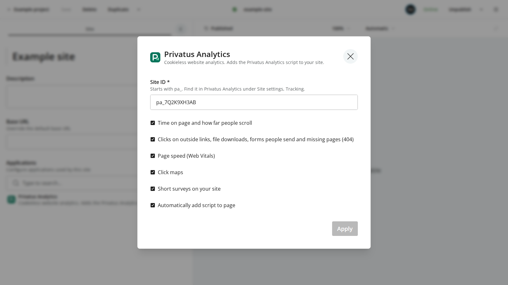

# Privatus Analytics for Enonic XP

**Real visitor numbers for your Enonic XP sites. No cookies, no cookie pop-up, no bots.**

You want to know if people visit your site. But Google Analytics uses cookies,
so in many countries you must show a cookie pop-up first (the box that asks
visitors to say yes to cookies). Many people click no, so they never show up in
your numbers. Bots add fake visits on top.

This app adds the Privatus Analytics script to every page of your Enonic XP
site. You paste your site ID once in the site config. The script sets no
cookies and keeps no IP addresses. Bots are filtered out before they are
counted.

So you see how many real people came, which pages they looked at and where they
came from, on one simple dashboard. A report comes to your inbox each week, and
you can set alerts for when traffic jumps or drops. And you don't need a cookie
pop-up for your analytics.

**Free plan, no card:** 10,000 events a month (an event is a page view or an action you track) on up to 3 sites. [Start free at privatusanalytics.com](https://privatusanalytics.com).

- **No cookies.** No cookies and no hidden IDs on your visitors' devices, and no IP
  addresses are kept. Laws differ by country, so check your own legal advice.
- **Real people, not bots.** Known bots, data centers and spam visits are left
  out on every plan.
- **Small and fast.** The script is about 3 KB when compressed.



## Requirements

- Enonic XP 8.1 or later.
- A Privatus Analytics site ID. It starts with `pa_`. You find it in Privatus
  Analytics under Site settings, Tracking.

## Install

Install **Privatus Analytics** from [Enonic Market](https://market.enonic.com):

1. Open the **Applications** tool in your XP admin.
2. Click **Install** and search for **Privatus Analytics**.
3. Click **Install** next to it.

You can also download the JAR and drop it in the `deploy` folder of your XP home:

```text
https://raw.githubusercontent.com/Privatus-Analytics/enonic-privatus-analytics/maven/com/privatusanalytics/privatus-analytics/1.0.0/privatus-analytics-1.0.0.jar
```

## Setup

1. Open **Content Studio** and edit your site.
2. Under **Applications**, add **Privatus Analytics**.
3. Click the pencil next to **Privatus Analytics** to open its site config.
4. Paste your site ID, pick the extra tracking you want and click **Apply**.
5. Save and publish the site.

Until the site has a valid site ID, the app adds nothing to your pages.

## Settings

| Setting | What it does |
| --- | --- |
| **Site ID** | Your Privatus Analytics site ID, like `pa_7Q2K9XH3AB`. It is required. A value that does not look like a site ID is not saved. |
| **Time on page and how far people scroll** | Loads the `engage` module. |
| **Clicks on outside links, file downloads, forms people send and missing pages (404)** | Loads the `auto` module. |
| **Page speed (Web Vitals)** | Loads the `vitals` module. |
| **Click maps** | Loads the `clicks` module. It counts clicks on each link and button. |
| **Short surveys on your site** | Loads the `ask` module. It shows the surveys you make in Privatus Analytics. |
| **Automatically add script to page** | On by default. Turn it off for a headless site (see below). |

All five tracking boxes are ticked by default. The app then adds this to the
`<head>` of each page:

```html
<script defer src="https://privatusstats.com/js/pa.js" data-site="pa_YOURSITEID" data-modules="engage,auto,vitals,clicks,ask"></script>
```

`data-modules` lists only the boxes you tick, in this order. If you untick all
five, it is written as `data-modules=""`, so the script loads no extra modules
and only counts page views.

The script is only added to pages people see on your live site. Content Studio
preview and the page editor never get it, so your own editing is not counted.

### Content Security Policy

If your site sets a Content Security Policy (a rule list that tells the browser
which scripts it may run), the app adds `https://privatusstats.com` to it. It
uses the rule that covers scripts and the rule that covers requests the page
sends. If your policy uses `'strict-dynamic'`, the script tag also gets the
page's nonce (a one-time code that marks the script as allowed).

### Headless sites

If your pages are built by another app (a headless site), turn off
**Automatically add script to page** and add the script tag above to that app's
pages yourself.

## External service

When a site has a site ID, every live page loads
`https://privatusstats.com/js/pa.js` in the visitor's browser. The script sends
the page address (query parameters are removed except campaign parameters), the
referrer, the browser language, the screen width, the time zone name and event
names to `https://privatusstats.com/api/event`. The visitor's IP address is read
in memory to work out a rough country and to count unique visits, and it is not
stored.

- Terms of service: https://privatusanalytics.com/legal/terms
- Privacy policy: https://privatusanalytics.com/legal/privacy
- Docs: https://privatusanalytics.com/docs

## Development

You only need Docker. The app is built with Gradle and Java 25 inside a
container:

```sh
docker run --rm -v "$PWD":/app -v privatus-analytics-gradle:/root/.gradle -w /app \
  eclipse-temurin:25-jdk ./gradlew build
```

The JAR lands in `build/libs/privatus-analytics.jar`.

To test it in a real Enonic XP 8 with Content Studio:

```sh
./scripts/verify-docker.sh
```

This builds the app and a small test app (`tests/fixture-app`), starts
`enonic/xp:8.1.2-ubuntu`, creates one test site per case and checks the
`<head>` of each page: the right tag for a valid site ID, no tag for a missing
or wrong site ID, no tag in preview and edit mode, no tag when the automatic
script is off, and the Content Security Policy changes.

To publish a new version to the Maven folder on the `maven` branch:

```sh
./scripts/publish-maven-branch.sh          # build, publish and commit (no push)
PUSH=1 ./scripts/publish-maven-branch.sh   # same, then push
```

## License

MIT. See `LICENSE.txt` and `NOTICE.txt`.
